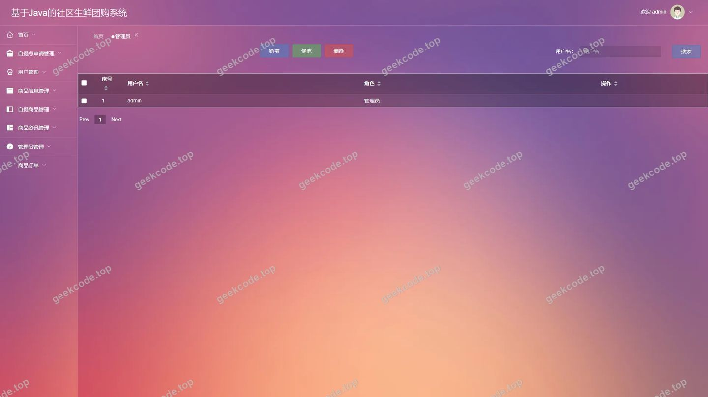
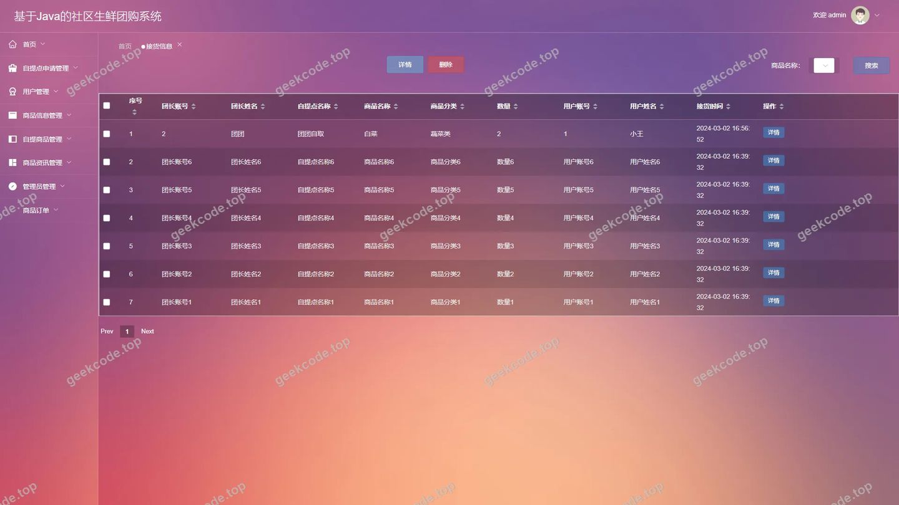
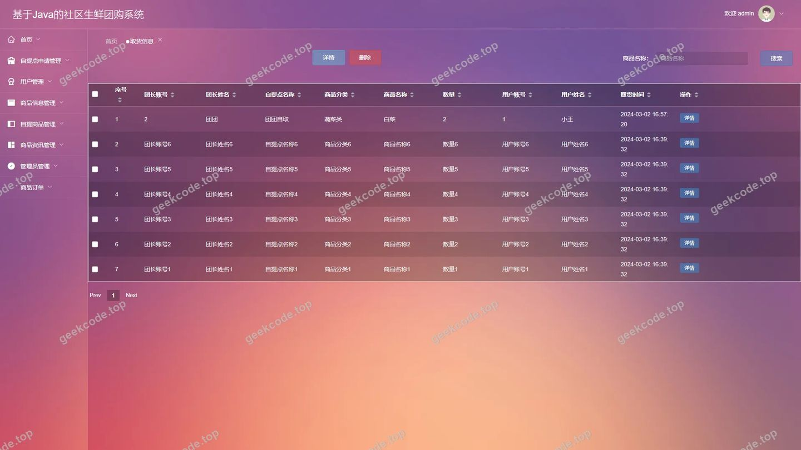
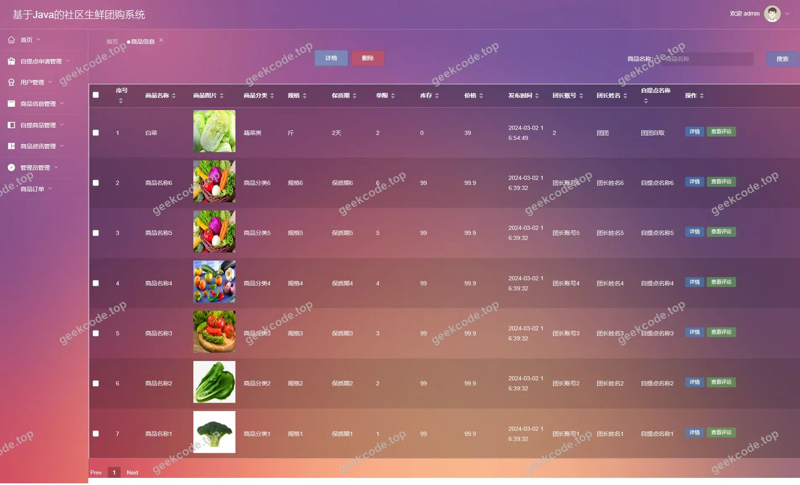
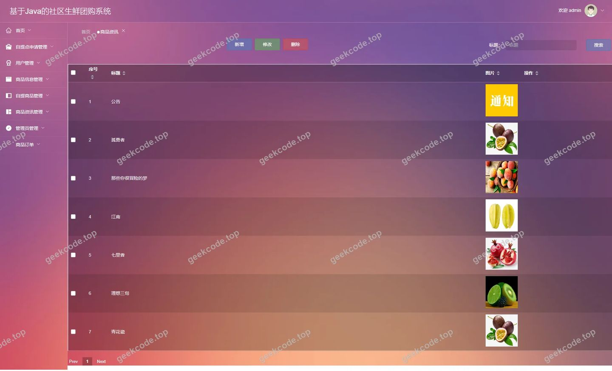
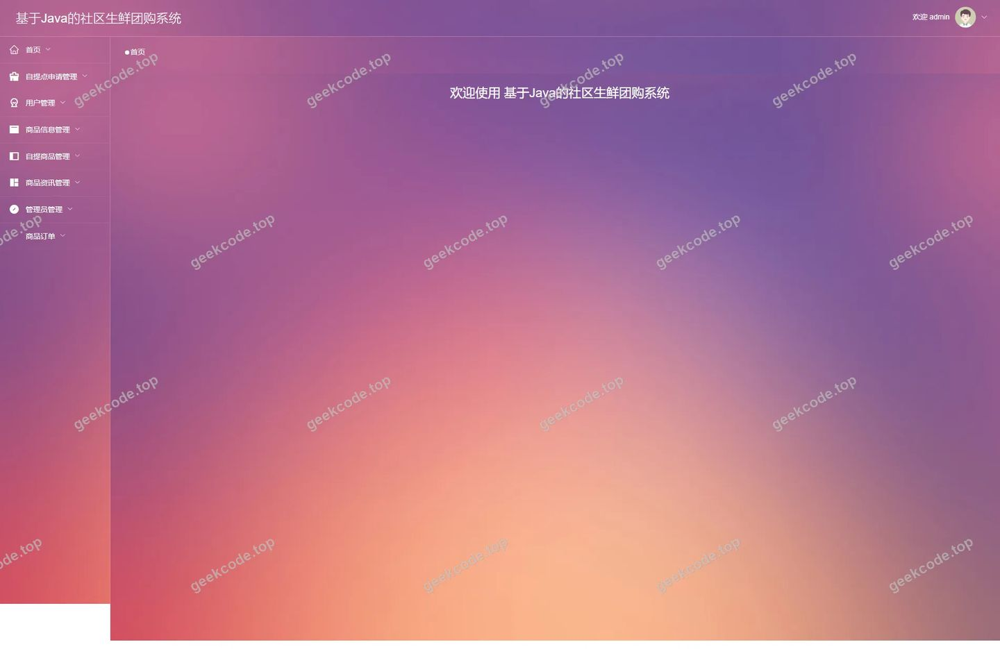
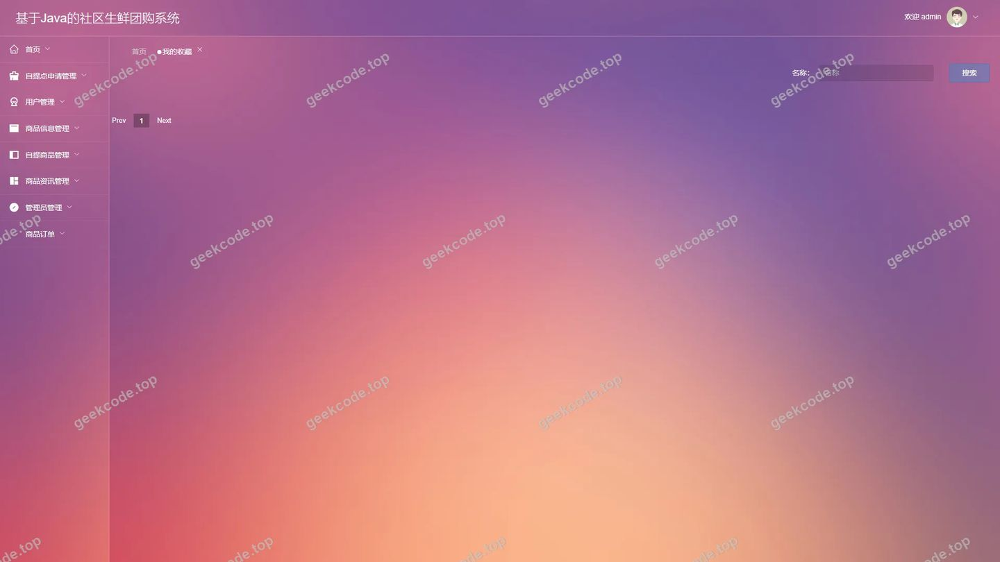

# 基于Java的社区生鲜团购系统

> 🎓 **计算机毕业设计 · 基于Java的社区生鲜团购系统**
>
> 本仓库只放**项目介绍 + 运行截图**（截图是站点带水印的原图，存在仓库 `images/` 里）。
>
> 👉 **完整可运行源码 / 数据库脚本 / 部署文档：[点我获取](https://geekcode.top/archives/%E5%9F%BA%E4%BA%8EJava%E7%9A%84%E7%A4%BE%E5%8C%BA%E7%94%9F%E9%B2%9C%E5%9B%A2%E8%B4%AD%E7%B3%BB%E7%BB%9F?utm_source=github)**
>
> 💬 咨询微信：**ir9372**　|　🌐 更多项目：[极客代码 geekcode.top](https://geekcode.top/?utm_source=github)
>
> 📌 项目详情页：<https://geekcode.top/archives/%E5%9F%BA%E4%BA%8EJava%E7%9A%84%E7%A4%BE%E5%8C%BA%E7%94%9F%E9%B2%9C%E5%9B%A2%E8%B4%AD%E7%B3%BB%E7%BB%9F?utm_source=github>

<table><td width="230" align="center"> <b>扫码加微信 ir9372</b></td><td valign="middle">📦 源码 = 项目介绍 + 全部运行截图 + 数据库 + 部署文档 👉 点上方任意截图，直接跳到 <b>极客代码 geekcode.top</b> 详情页</td></table>

---

<h1>基于Java的社区生鲜团购系统</h1>
<h2>项目概述</h2>

本项目旨在构建一个基于 Java 的社区生鲜团购系统，解决传统生鲜零售中流通环节多、损耗大及配送成本高的问题。系统采用前后端分离架构，通过整合社区团长资源，实现从用户下单、商品采购到集中接货、分发取货的全流程数字化管理。核心功能涵盖商品信息管理、订单处理、物流节点监控（接货与取货）以及用户互动评价。适用人群包括社区居民（消费者）、社区团长（运营者）及平台管理员。技术架构上，后端基于 Spring Boot 框架，利用 MyBatis-Plus 进行数据持久化，Shiro 保障安全权限，前端结合 Vue 生态，确保系统的高效性与可维护性，为社区生鲜电商提供稳定可靠的信息化解决方案。

<h2>技术架构</h2>

本系统采用经典的前后端分离开发模式，整体架构分为表现层、业务逻辑层和数据访问层。

<strong>1. 后端架构</strong>

<ul>
<li><strong>核心框架</strong>：使用 <code>spring-boot-starter-web</code> 构建 RESTful API 接口，简化配置并提升开发效率。</li>
<li><strong>数据持久层</strong>：集成 <code>mybatis-spring-boot-starter</code> 和 <code>mybatis-plus</code>，利用其代码生成器及通用 CRUD 功能，大幅减少样板代码，提高数据库操作灵活性。底层依赖 <code>mysql-connector-java</code> 连接 MySQL 数据库。</li>
<li><strong>安全控制</strong>：引入 <code>shiro-spring</code> 实现身份认证与授权管理，确保不同角色（如普通用户、团长、管理员）只能访问其权限范围内的资源。</li>
<li><strong>辅助组件</strong>：使用 <code>commons-lang3</code> 提供常用工具类支持，<code>validation-api</code> 用于参数校验，<code>protobuf-java</code> 可能用于特定数据序列化场景。</li>
</ul>

<strong>2. 前端架构</strong>

<ul>
<li><strong>技术栈</strong>：虽然具体前端框架未在依赖列表中详细展开，但根据路由结构（如 <code>/index/...</code>）及项目类型 <code>vue-integrated</code>，推断前端采用 Vue.js 框架构建单页面应用（SPA）。</li>
<li><strong>交互设计</strong>：通过 Axios 等 HTTP 客户端调用后端接口，实现动态数据渲染。前台面向用户展示商品列表、详情及个人中心；后台面向管理员提供数据管理与审核界面。</li>
</ul>

<strong>3. 数据库设计要点</strong>

<ul>
<li>基于实体关系建模，主要表结构涵盖用户信息 (<code>yonghu</code>)、团长信息 (<code>tuanzhang</code>)、商品分类 (<code>shangpinfenlei</code>)、商品信息 (<code>shangpinxinxi</code>)、订单记录 (<code>orders</code>)、物流节点信息（接货 <code>jiehuoxinxi</code>、取货 <code>quhuoxinxi</code>）、收藏记录 (<code>storeup</code>)、评论信息 (<code>discussshangpinxinxi</code>) 及资讯新闻 (<code>news</code>)。</li>
<li>通过外键或业务 ID 关联各实体，确保数据一致性。例如，订单表关联用户 ID 和商品 ID，取货信息关联订单 ID 以追踪履约状态。</li>
</ul>
<h2>功能模块</h2>

根据提供的路由配置及截图功能列表，系统功能划分为前台用户端和后台管理端两大板块。

<h3>1. 前台用户端功能</h3>

前台主要服务于普通消费者和注册团长，侧重于浏览、交易与信息维护。

<ul>
<li><strong>首页与资讯</strong>：展示最新商品推荐、社区公告及新闻资讯入口。</li>
<li><strong>用户管理</strong>：</li>
<li><strong>注册与登录</strong>：新用户可通过 <code>/yonghuRegister</code> 完成账号注册，已有用户通过登录页进入系统。</li>
<li><strong>个人中心</strong>：查看个人基本信息、修改资料。</li>
<li><strong>团长入驻</strong>：通过 <code>/tuanzhangRegister</code> 申请成为社区团长，需经过审核流程。</li>
<li><strong>商品浏览与搜索</strong>：</li>
<li><strong>分类导航</strong>：按商品类别（<code>/index/shangpinfenleiList</code>）筛选生鲜产品。</li>
<li><strong>商品详情</strong>：查看商品图片、描述、价格及库存（<code>/index/shangpinxinxiDetail</code>）。</li>
<li><strong>用户评价</strong>：阅读其他用户对商品的讨论与评分（<code>/index/discussshangpinxinxi</code> 相关展示）。</li>
<li><strong>购物车与订单</strong>：</li>
<li><strong>购物车管理</strong>：添加、删除商品，调整数量（<code>/index/cartList</code>）。</li>
<li><strong>订单确认</strong>：选择收货方式、提交订单（<code>/index/order_confirm</code>）。</li>
<li><strong>订单查询</strong>：查看历史订单状态及详情（<code>/index/ordersList</code>）。</li>
<li><strong>物流跟踪</strong>：</li>
<li><strong>接货信息</strong>：查看团长接收货物的时间与地点安排（<code>/index/jiehuoxinxiList</code>）。</li>
<li><strong>取货信息</strong>：查看用户自提点的取货通知与状态（<code>/index/quhuoxinxiList</code>）。</li>
<li><strong>互动功能</strong>：</li>
<li><strong>我的收藏</strong>：管理感兴趣的商品列表（<code>/index/storeupList</code>）。</li>
<li><strong>自提点申请</strong>：查看或申请新的自提站点（<code>/index/zitidianshenqingList</code>）。</li>
</ul>
<h3>2. 后台管理端功能</h3>

后台主要服务于系统管理员，负责全局数据的维护、审核与配置。

<ul>
<li><strong>仪表盘首页</strong>：展示关键业务指标概览。</li>
<li><strong>用户与团长管理</strong>：</li>
<li><strong>用户管理</strong>：查看、编辑、禁用普通用户账号（<code>/users</code>, <code>/yonghu</code>）。</li>
<li><strong>团长管理</strong>：审核团长资质，管理团长账户信息（<code>/tuanzhang</code>, <code>/tuanzhangCenter</code>）。</li>
<li><strong>商品与分类管理</strong>：</li>
<li><strong>商品信息管理</strong>：上架、下架、编辑商品详情及库存（<code>/shangpinxinxi</code>）。</li>
<li><strong>商品分类管理</strong>：维护生鲜商品的类目结构（<code>/shangpinfenlei</code>）。</li>
<li><strong>订单与物流管理</strong>：</li>
<li><strong>订单管理</strong>：查看所有订单状态，处理退款或异常订单（<code>/orders</code>）。</li>
<li><strong>接货信息管理</strong>：录入和管理团长的货物接收记录（<code>/jiehuoxinxi</code>）。</li>
<li><strong>取货信息管理</strong>：管理用户的取货凭证与状态更新（<code>/quhuoxinxi</code>）。</li>
<li><strong>内容与安全设置</strong>：</li>
<li><strong>资讯管理</strong>：发布社区新闻或促销公告（<code>/news</code>）。</li>
<li><strong>评论管理</strong>：审核或删除违规的用户评论（<code>/discussshangpinxinxi</code>）。</li>
<li><strong>收藏管理</strong>：查看用户收藏数据，辅助选品分析（<code>/storeup</code>）。</li>
<li><strong>自提点审核</strong>：审批用户提交的自提点申请（<code>/zitidianshenqing</code>）。</li>
<li><strong>系统配置</strong>：修改网站基础参数、轮播图等配置项（<code>/config</code>）。</li>
</ul>
<h2>用户角色与权限</h2>

系统基于 Shiro 框架实现了细粒度的权限控制，主要包含以下三种角色：

<table>
<thead>
<tr>
<th align="left">角色</th>
<th align="left">权限范围</th>
<th align="left">可访问的具体功能模块</th>
</tr>
</thead>
<tbody><tr>
<td align="left"><strong>普通用户 (Yonghu)</strong></td>
<td align="left">仅限前台浏览、购买及个人数据维护</td>
<td align="left">1. <strong>注册/登录</strong>：前台用户注册2. <strong>商品浏览</strong>：首页、商品分类列表、商品详情3. <strong>交易流程</strong>：加入购物车、订单确认、我的订单列表4. <strong>个人信息</strong>：个人中心、我的收藏、消息通知5. <strong>物流查询</strong>：查看接货信息、查看取货信息6. <strong>互动</strong>：发表评论、查看他人评论7. <strong>申请</strong>：提交自提点申请</td>
</tr>
<tr>
<td align="left"><strong>社区团长 (Tuanzhang)</strong></td>
<td align="left">在普通用户基础上增加团长专属业务</td>
<td align="left">1. <strong>所有普通用户权限</strong>2. <strong>团长中心</strong>：查看所属社区的订单汇总、接货任务管理3. <strong>资质维护</strong>：更新团长个人信息、管理自提点状态4. <strong>特殊入口</strong>：通过团长注册通道入驻，拥有独立的数据视图</td>
</tr>
<tr>
<td align="left"><strong>系统管理员 (Admin)</strong></td>
<td align="left">最高权限，负责全系统数据管理与配置</td>
<td align="left">1. <strong>后台登录</strong>：管理员专用登录页2. <strong>用户管理</strong>：管理普通用户账号、审核团长资格3. <strong>商品管理</strong>：增删改查商品分类、上架/下架商品、编辑详情4. <strong>订单管理</strong>：查看全部订单、处理售后、导出报表5. <strong>物流管理</strong>：录入/审核接货信息、更新取货状态6. <strong>内容管理</strong>：发布新闻公告、审核用户评论7. <strong>系统设置</strong>：配置网站参数、管理轮播图、权限分配</td>
</tr>
</tbody></table>
<h2>项目特色与创新点</h2>
<ol>
<li><strong>全流程闭环管理</strong>：系统不仅涵盖了传统的“购”环节，还深度整合了社区团购特有的“集采-分拨-自提”物流链路。通过独立的“接货信息”和“取货信息”模块，清晰界定了团长与用户在物流节点的权责，解决了生鲜电商最后一公里交付难、状态不透明的问题。</li>
<li><strong>双角色协同机制</strong>：创新性地设计了“普通用户”与“社区团长”的双轨制注册与管理流程。团长作为关键节点，既具备消费者的购物权限，又拥有特定的运营视角（如团长中心），这种设计符合社区团购“熟人经济+社群运营”的业务本质。</li>
<li><strong>灵活的自提点生态</strong>：引入“自提点申请”功能，允许用户或潜在团长参与基础设施的建设与优化，体现了系统的开放性与社区共建理念，有助于快速拓展覆盖范围。</li>
<li><strong>安全稳定的技术底座</strong>：选用成熟稳定的 Spring Boot + MyBatis-Plus + Shiro 组合，在保证开发效率的同时，通过 Shiro 实现了严格的会话管理和权限隔离，确保了交易数据和用户隐私的安全性。</li>
</ol>
<h2>部署环境</h2>

为确保系统正常运行，需准备以下软件及硬件环境：

<ul>
<li><strong>操作系统</strong>：Windows 10/11, Linux (CentOS 7+, Ubuntu 20.04+) 或 macOS。</li>
<li><strong>Java 运行环境</strong>：JDK 1.8 及以上版本（建议 JDK 8 或 JDK 11，兼容 Spring Boot 2.x 系列）。</li>
<li><strong>数据库管理系统</strong>：MySQL 5.7 或 MySQL 8.0，需初始化对应的 SQL 脚本以创建表结构。</li>
<li><strong>Web 服务器</strong>：内置 Tomcat（由 Spring Boot Starter Web 提供），无需额外安装外部容器；若生产环境建议配合 Nginx 进行反向代理。</li>
<li><strong>构建工具</strong>：Maven 3.6+（用于后端依赖管理及打包）。</li>
<li><strong>前端运行环境</strong>：Node.js (LTS 版本，建议 v14-v18) 及 npm/yarn（用于前端项目依赖安装及编译打包）。</li>
<li><strong>浏览器</strong>：Chrome, Edge, Firefox 等现代主流浏览器。</li>
</ul>
<h2>五、技术特性</h2>
<ul>
<li>前后端集成部署，前端资源打包至后端 static 目录</li>
<li>使用 MyBatis-Plus 简化数据访问层开发</li>
<li>集成 Shiro 权限框架实现角色权限控制</li>
</ul>
<h2>六、功能模块截图</h2>
<h3>前台用户端</h3>
<h4>前台-首页</h4>

<h4>前台-登录</h4>

<h4>前台-用户注册</h4>

<h3>后台管理端</h3>
<h4>后台-登录页</h4>

<h4>后台-管理员</h4>

<h4>后台-接货信息</h4>

<h4>后台-取货信息</h4>

<h4>后台-商品信息</h4>

<h4>后台-商品资讯</h4>

<h4>页面-首页</h4>

<h4>后台-我的收藏</h4>

---

## 获取完整源码

| 项目 | 说明 |
| --- | --- |
| 项目名 | 基于Java的社区生鲜团购系统 |
| 运行截图 | 本文 11 张（站点带水印原图，仓库 `images/` 目录） |
| 完整源码 | [https://geekcode.top/archives/%E5%9F%BA%E4%BA%8EJava%E7%9A%84%E7%A4%BE%E5%8C%BA%E7%94%9F%E9%B2%9C%E5%9B%A2%E8%B4%AD%E7%B3%BB%E7%BB%9F?utm_source=github](https://geekcode.top/archives/%E5%9F%BA%E4%BA%8EJava%E7%9A%84%E7%A4%BE%E5%8C%BA%E7%94%9F%E9%B2%9C%E5%9B%A2%E8%B4%AD%E7%B3%BB%E7%BB%9F?utm_source=github) |
| 咨询微信 | **ir9372**（备注：jingpin-yuanma） |
| 更多项目 | [极客代码 geekcode.top](https://geekcode.top/?utm_source=github) |

> 需要源码、部署、改配置、跑不起来等问题，加微信 ir9372 沟通，说明项目名即可。
